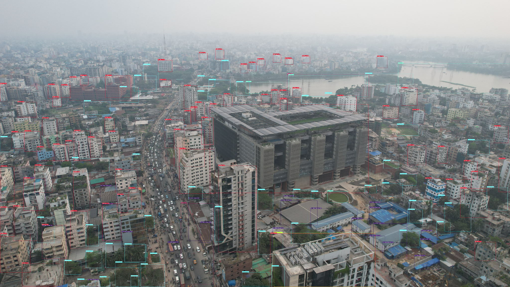
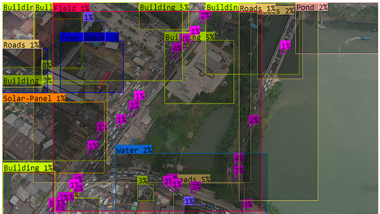

# Drone-Based Urban Infrastructure Detection

**IEEE ICECE 2024 Research | Computer Vision | Object Detection | Aerial Imagery | Urban Planning**

Research repository for **“Enhancing Infrastructure Detection Using Drone Imagery: A Comparative Analysis Using Machine Learning Models with a Custom Bangladesh-Based Dataset for Improved Urban Planning.”**

## Research Overview

This undergraduate research investigates automated infrastructure detection in drone-captured imagery of Bangladesh for urban-planning applications. The study combines a custom, locally collected aerial-imagery dataset with comparative analysis of machine-learning object-detection approaches.

The research covers **YOLOv5, YOLOv7, YOLOv8, and a custom model**, using a dataset prepared through drone-based image acquisition and manual annotation across **11 infrastructure classes**.

## Research Highlights

- **Locally collected aerial imagery:** Drone-based acquisition of images from Bangladesh to study urban infrastructure.
- **Custom dataset development:** Dataset preparation and class-by-class manual image annotation.
- **Comparative object detection:** Investigation of YOLOv5, YOLOv7, YOLOv8, and a custom model.
- **Urban-planning relevance:** Infrastructure recognition and analysis from aerial imagery.
- **Peer-reviewed conference publication:** Presented through IEEE ICECE 2024 research proceedings.

## Experimental Evidence

Selected prediction examples from the original thesis presentation are shown below. These are original research figures, not newly generated demonstrations.

| YOLOv5 | YOLOv8 |
| :---: | :---: |
|  |  |

| YOLOv7 | Custom Model |
| :---: | :---: |
|  |  |

**[Explore all 13 original experimental figures](docs/experimental-figure-gallery.md)**, including training figures, results figures, and the geolocation demonstration. See the [experimental results documentation](docs/results-and-demonstrations.md) for the thesis presentation's context and slide references.

## Research Findings

The thesis presentation reports experimental comparisons across YOLOv5, YOLOv7, YOLOv8, and a custom detection approach.

- **Detection across models:** The team documented training results and aerial-image predictions for all four approaches, enabling qualitative examination of their behavior on infrastructure imagery.
- **Locally collected imagery:** The presentation illustrates stronger detection on Bangladesh-based imagery than on selected foreign-image examples for the team's model. This is a qualitative comparison, not a universal generalization claim.
- **Applied demonstration:** The research includes an image-geolocation and Google Maps demonstration to connect aerial-image analysis with spatial context.

The original experimental figures and [slide-referenced discussion](docs/results-and-demonstrations.md) provide the supporting evidence. Because the preserved notebooks reference different dataset export versions, the repository does not claim a newly standardized, like-for-like numerical benchmark.

## Publication

**Enhancing Infrastructure Detection Using Drone Imagery: A Comparative Analysis Using Machine Learning Models with a Custom Bangladesh-Based Dataset for Improved Urban Planning**

*2024 13th International Conference on Electrical and Computer Engineering (ICECE)*

**DOI:** [10.1109/ICECE64886.2024.11025116](https://doi.org/10.1109/ICECE64886.2024.11025116)

## Research Contributions

As a co-author of this undergraduate thesis research, I contributed to drone-imagery dataset preparation, manual image annotation, results analysis and visualization, and research writing and documentation. The work was conducted collaboratively with the research team.

## Technical Scope

| Area | Methods and technologies |
| --- | --- |
| Research domain | Computer vision, aerial imagery, infrastructure detection |
| Detection approaches | YOLOv5, YOLOv7, YOLOv8, custom model |
| Data acquisition | Drone-captured imagery from Bangladesh |
| Dataset preparation | Manual annotation of 11 infrastructure classes |
| Research analysis | Comparative model results and infrastructure analysis |
| Application | Urban planning and infrastructure monitoring |

## Explore the Research

| Research resource | Contents |
| --- | --- |
| [Original research notebooks](notebooks/) | YOLOv5, YOLOv7, YOLOv8, and custom-image inference |
| [Trained YOLOv8 checkpoint](bestv8.pt) | Original trained model weights |
| [YOLOv8 model details](docs/yolov8-model.md) | Architecture, configuration, and 11-class taxonomy |
| [Dataset methodology](docs/dataset-methodology.md) | Drone acquisition, annotation, and preprocessing |
| [Experiment configurations](docs/experiment-configurations.md) | Training parameters from the original notebooks |
| [Results and demonstrations](docs/results-and-demonstrations.md) | Detection experiments and research demonstrations |
| [Original experimental figure gallery](docs/experimental-figure-gallery.md) | 13 figures from the final thesis presentation |
| [Research workflow](docs/research-workflow.md) | Acquisition-to-analysis methodology |
| [Research team](docs/research-team.md) | Thesis authors and academic supervision |
| [Reproducibility guide](docs/reproducibility-guide.md) | Dataset versions, experiment commands, and checkpoint inference |
| [Research materials index](docs/research-materials.md) | Direct links to all preserved artifacts |
