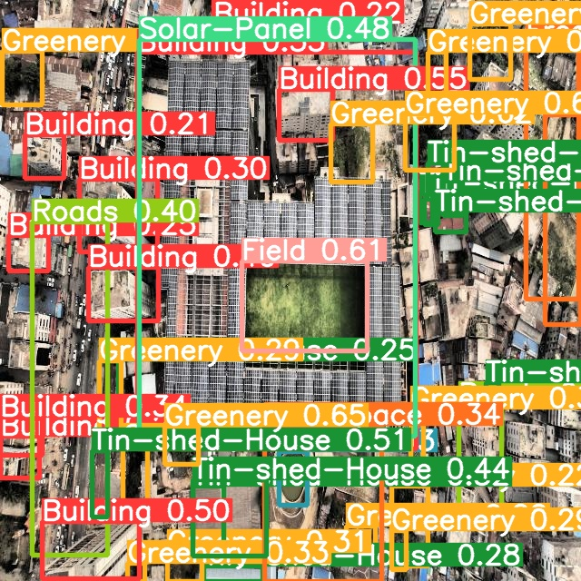
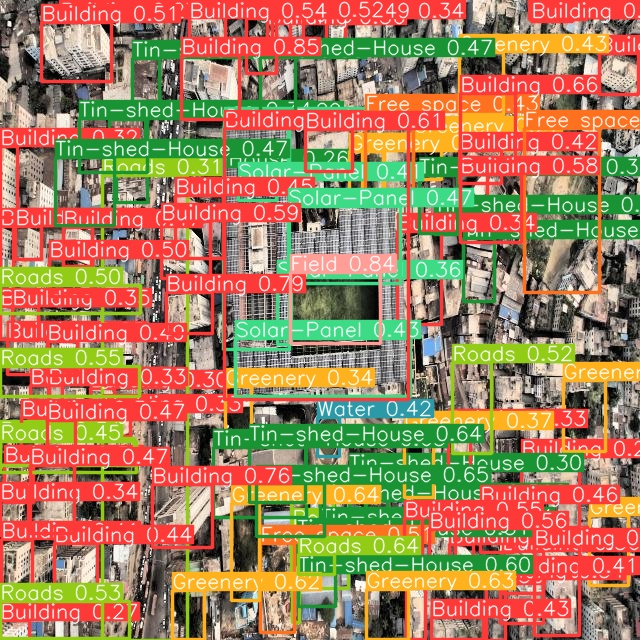

# Drone-Based Urban Infrastructure Detection

**IEEE ICECE 2024 | Computer Vision | Aerial Imagery | Object Detection | Urban Planning**

**Published research:** [Enhancing Infrastructure Detection Using Drone Imagery: A Comparative Analysis Using Machine Learning Models with a Custom Bangladesh-Based Dataset for Improved Urban Planning](https://doi.org/10.1109/ICECE64886.2024.11025116)

This undergraduate research investigates **urban infrastructure detection from drone imagery in Bangladesh**. The study combines an original, manually annotated aerial-imagery dataset with experiments involving **YOLOv5, YOLOv7, YOLOv8, and a custom detection approach** to explore applications in urban planning.

## Research Highlights

- **Original Bangladesh-based dataset:** Drone imagery collected by the research team around BRAC University's new campus in Merul Badda, Dhaka.
- **Multi-stage acquisition:** Three image-collection sessions, approximately two months apart, to observe the surrounding urban environment at different stages.
- **Dataset development:** 350 raw drone photographs, 17 videos, approximately 50,000 manual annotations, and **11 infrastructure classes**, as documented in the thesis.
- **Comparative computer vision research:** Experimental training results, detection examples, and qualitative analysis across four detection approaches.
- **IEEE conference publication:** Research presented through the 2024 13th International Conference on Electrical and Computer Engineering (ICECE).

## Dataset Development

The team acquired aerial imagery from the rooftop of BRAC University's new campus, documenting the surrounding urban landscape during a period of rapid development. Images were prepared and manually annotated using Roboflow to support detection of buildings, roads, vegetation, vehicles, and other infrastructure features.

The dataset includes **11 object classes**: Building, Field, Free space, Greenery, Human, Pond, Roads, Solar-Panel, Tin-shed-House, Vehicles, and Water.

[**Explore dataset acquisition and annotation**](docs/bangladesh-dataset-showcase.md)

## Experimental Results & Visualizations

The thesis investigated YOLOv5, YOLOv7, YOLOv8, and a custom model for aerial-image infrastructure detection. Selected experimental prediction examples are shown below.

| YOLOv5 | YOLOv8 |
| :---: | :---: |
|  |  |

| YOLOv7 | Custom Model |
| :---: | :---: |
|  |  |

**Key observations documented in the thesis:**

- **Comparative detection:** The study presents training results and prediction examples for each detection approach, supporting analysis of infrastructure recognition in aerial imagery.
- **Image-domain behavior:** Selected comparisons illustrate differences in detection behavior between locally collected Bangladesh-based imagery and foreign-image examples.
- **Geolocation demonstration:** The research also explores identifying an image's location and displaying the result through Google Maps.

[**View experimental results and visualizations**](docs/experimental-figure-gallery.md) · [**Read results analysis**](docs/results-and-demonstrations.md)

## My Research Contributions

As a co-author of this undergraduate research, **Nabila Islam Borno** contributed to:

- Preparation of the original drone-imagery dataset and manual object annotation.
- Participation in model-training runs and experiment evaluation with the research team.
- Analysis and visualization of experimental results.
- Research writing and documentation.

Drone acquisition and model experimentation were collaborative team activities.

## Publication

**Enhancing Infrastructure Detection Using Drone Imagery: A Comparative Analysis Using Machine Learning Models with a Custom Bangladesh-Based Dataset for Improved Urban Planning**

*2024 13th International Conference on Electrical and Computer Engineering (ICECE)*

**DOI:** [10.1109/ICECE64886.2024.11025116](https://doi.org/10.1109/ICECE64886.2024.11025116)

## Explore the Research

| Research resource | Description |
| --- | --- |
| [Research overview](docs/research-overview.md) | Research question, context, and significance |
| [Bangladesh-based dataset development](docs/bangladesh-dataset-showcase.md) | Drone acquisition, collection stages, and annotation |
| [Dataset methodology](docs/dataset-methodology.md) | Dataset preparation and preprocessing workflow |
| [Experimental Results & Visualizations](docs/experimental-figure-gallery.md) | Training results, model comparisons, detection outputs, and research visualizations |
| [Results and demonstrations](docs/results-and-demonstrations.md) | Comparative observations and geolocation demonstration |
| [Research notebooks](notebooks/) | YOLOv5, YOLOv7, YOLOv8, and custom-image inference |
| [Trained YOLOv8 model](bestv8.pt) | Model checkpoint and [technical details](docs/yolov8-model.md) |
| [Experiment configurations](docs/experiment-configurations.md) | Model settings and experimental parameters |
| [Research workflow](docs/research-workflow.md) | Acquisition-to-analysis research process |
| [Research team](docs/research-team.md) | Thesis team and academic supervision |
| [Technical reproduction guide](docs/reproducibility-guide.md) | Experiment commands and model inference |
