# Experimental Results & Visualizations

Training results, model outputs, and applied research visualizations from the undergraduate thesis are organized by detection approach.

## YOLOv5

**Training figure**

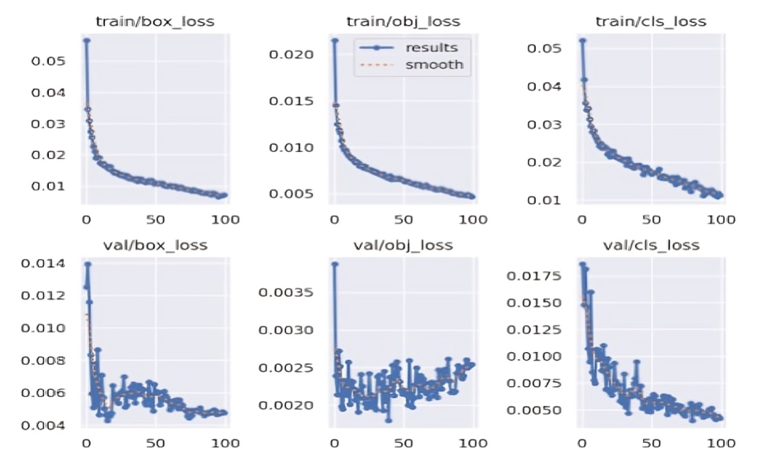

**Results figure**

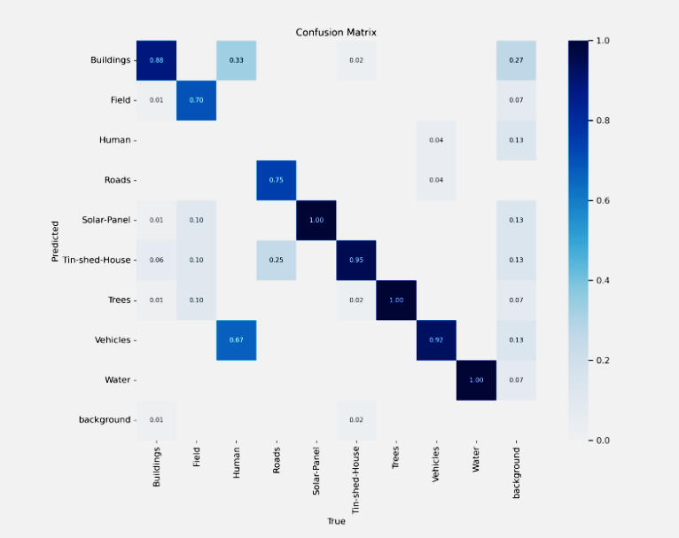

**Prediction examples**

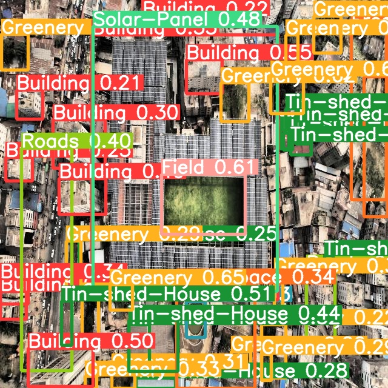

## YOLOv7

**Training figure**

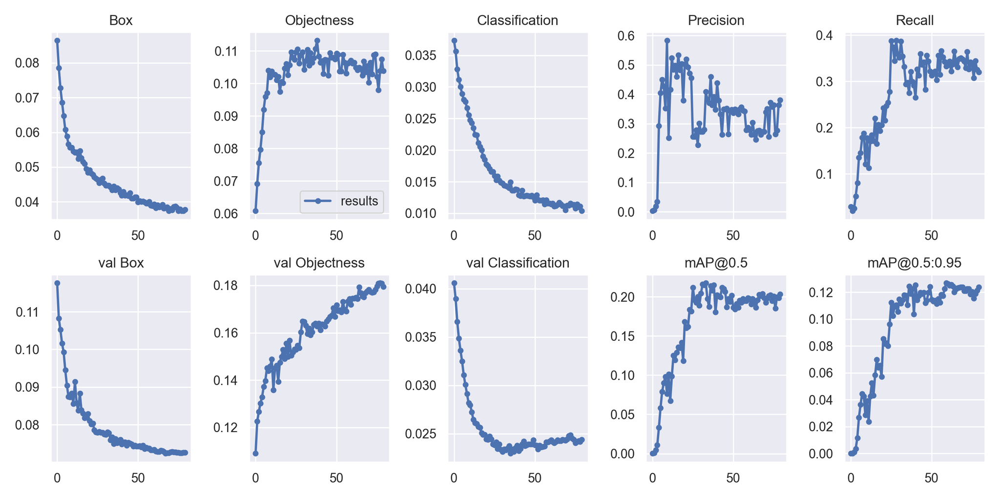

**Results figure**

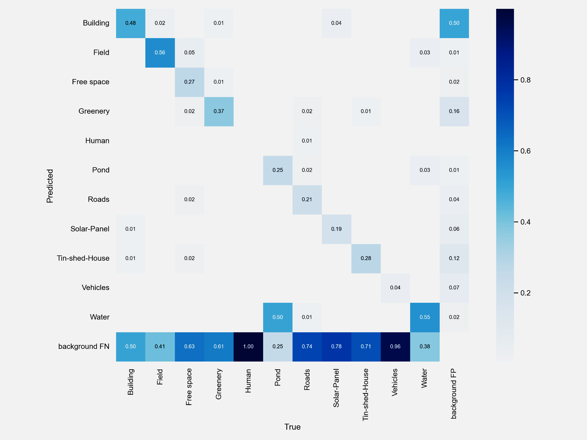

**Prediction examples**

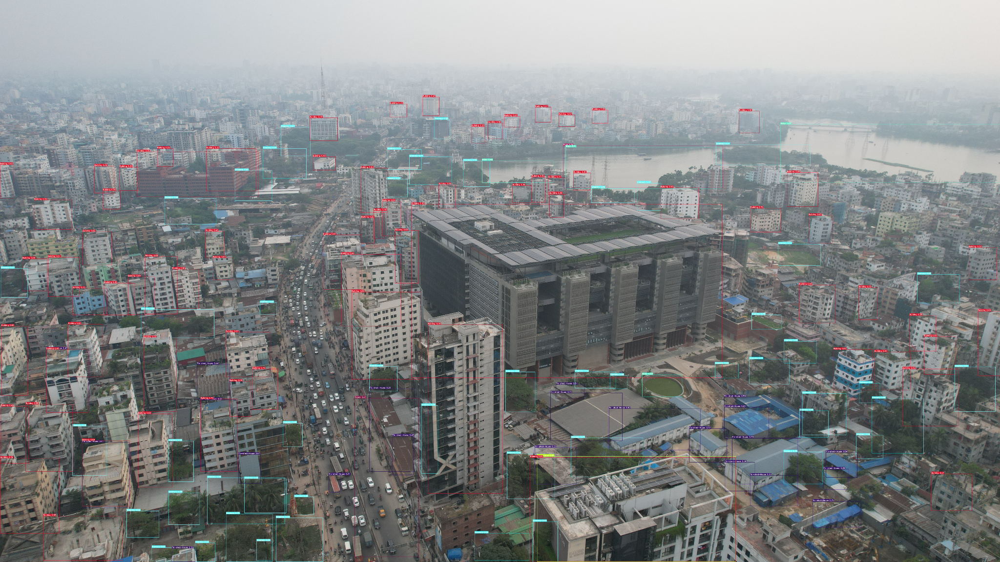

## YOLOv8

**Training figure**

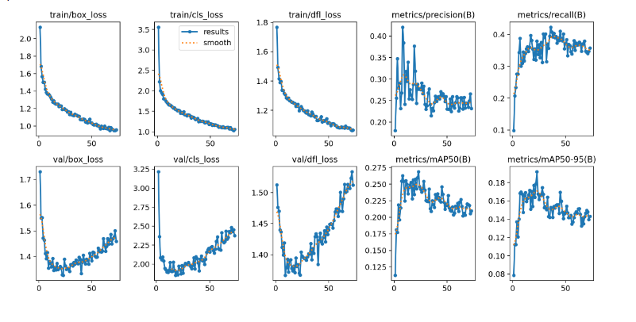

**Results figure**

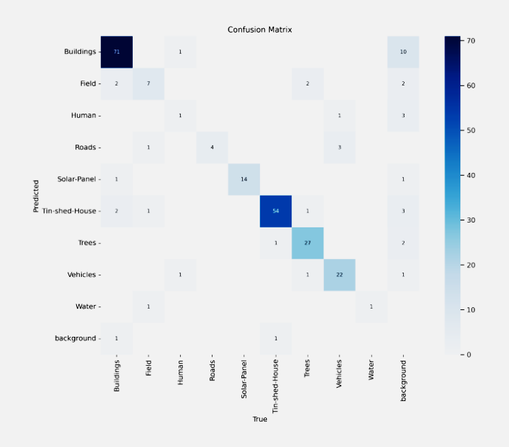

**Prediction examples**

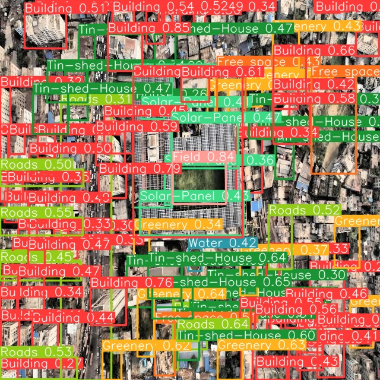

## Custom Model

**Training figure**

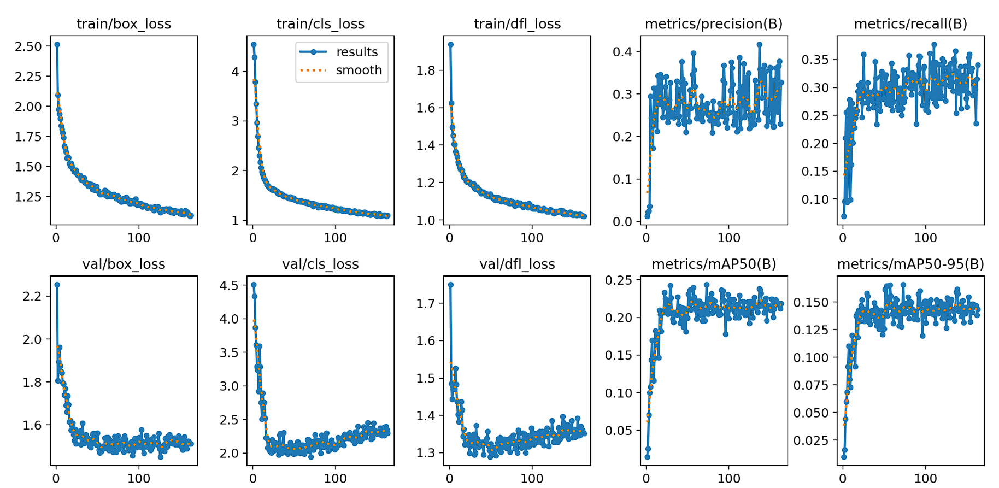

**Results figure**

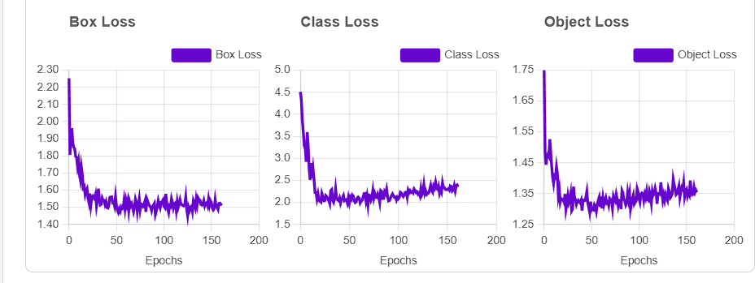

**Prediction examples**

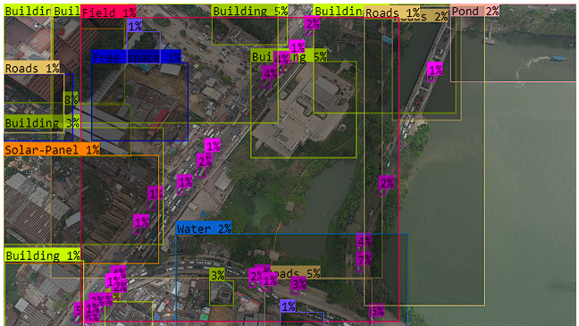

## Geolocation Demonstration

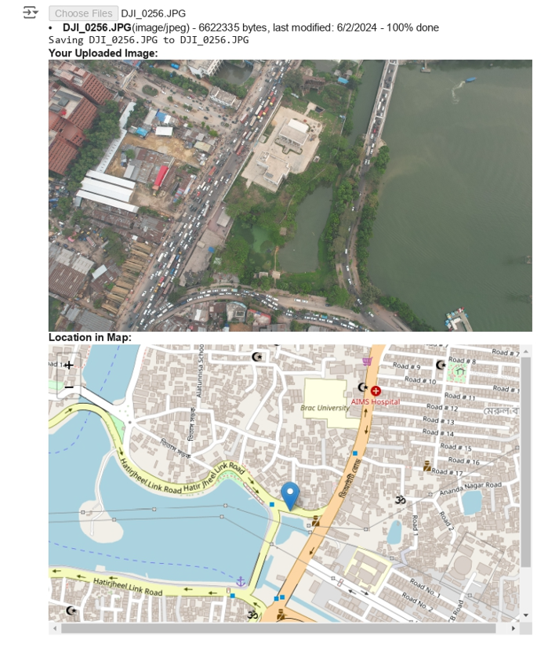

For the experimental context and slide references, see [Experimental Results and Research Demonstrations](results-and-demonstrations.md). For the published paper, see [IEEE ICECE DOI 10.1109/ICECE64886.2024.11025116](https://doi.org/10.1109/ICECE64886.2024.11025116).
